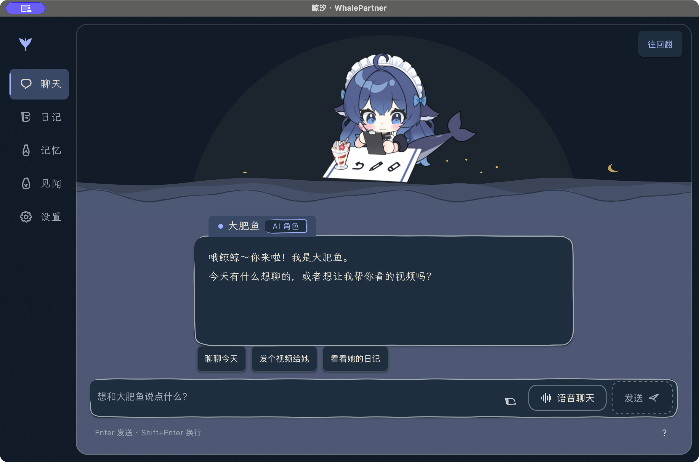

# WhalePartner · 鲸汐

[简体中文](README.md) | English

An AI companion with a whale-themed character who lives on your computer. She remembers what you tell her, watches Bilibili videos and reads web pages for you, and writes your day into a diary. Current version: **v0.4.0**. See [CHANGELOG.md](CHANGELOG.md) for release notes (written in Chinese).

<p align="center">
  
</p>

**Architecture**: a UI (`apps/client`, Tauri 2 + React 19) and a backend (`apps/api`, Node 26). **The desktop app bundles its own backend**: just double-click it, no separate terminal needed. **Closing the window quits the app** and stops the backend with it. If you want her to keep browsing after you close the window, turn on "Keep exploring in the background" in Settings. All devices of one user connect to the same "home" backend and stay in sync in real time; a phone or another computer can pair by scanning a QR code in the web app. The UI only displays things: model calls and data live in the backend.

**Just want to use it?** Download `WhalePartner_<version>_aarch64.dmg` from [Releases](https://github.com/OmnixSI/WhalePartner/releases/latest) (Apple Silicon Macs) and follow "Download and install" below. **Want to build it or hack on the code?** Read "Prerequisites" first, then walk through "Quick start". There is no CI.

> The project's docs under `docs/`, the changelog and the in-repo AI-agent notes are written in Chinese. The app itself ships with a full English UI.

---

## Download and install (macOS, Apple Silicon)

1. Download `WhalePartner_<version>_aarch64.dmg` from the [Releases](https://github.com/OmnixSI/WhalePartner/releases/latest) page (you can check it against the SHA-256 listed there).
2. Open the dmg and drag "鲸汐" (WhalePartner) into Applications.
3. The app is not notarized by Apple, so macOS blocks it the first time you open it. Pick one way to allow it: in Applications, right-click the app and choose **Open**; or double-click it once so macOS blocks it, then go to **System Settings › Privacy & Security**, scroll to the bottom and click **Open Anyway**.
4. Once it's running, enter your model key under **Settings › Model setup**. To switch the interface to English, go to **Settings › Look & use › Language**.

Early releases contain source code only. There are no ready-made installers for Intel Macs, Windows or Linux yet; build from source for those.

---

## Prerequisites

| Tool | Version | Used for | Install |
|---|---|---|---|
| Node.js | **26** (`.node-version`; the api's `engines` is `>=26 <27`) | Backend and frontend builds | `fnm install 26 && fnm use 26`, or nvm / the official site |
| pnpm | 10 or 12 | Package manager (each app has its own lockfile) | `npm i -g pnpm` |
| FFmpeg | any recent version | Video frame extraction and transcription (when you send a Bilibili link) | macOS `brew install ffmpeg`; Windows `winget install ffmpeg`; Linux `apt install ffmpeg` |
| Model source | pick one | The chat LLM | A DeepSeek API key (recommended, goes in `.env`); or a locally signed-in [Codex CLI](https://github.com/openai/codex) (fallback, currently reliable on macOS only) |
| Rust | ≥ 1.90 | Only for building/running the desktop window (`tauri build/dev`) | [rustup.rs](https://rustup.rs) |
| Chromium | the Playwright build | Only for the "she goes browsing on her own" feature ("finds") | `pnpm --dir apps/api exec playwright-core install chromium` |

Packaging on macOS also needs the Xcode Command Line Tools (`xcode-select --install`).

---

## Quick start

The common first step (any platform):

```sh
git clone https://github.com/OmnixSI/WhalePartner.git && cd WhalePartner
cp apps/api/.env.example apps/api/.env      # Windows: copy apps\api\.env.example apps\api\.env
pnpm --dir apps/api install
pnpm --dir apps/client install
```

### Desktop app (recommended)

```sh
pnpm --dir apps/client run tauri build      # the first Rust compile takes about 3 minutes; the backend is packed in first
```

- Output goes to `apps/client/src-tauri/target/release/bundle/` (on macOS: `macos/鲸汐.app`; Linux produces `deb`/`appimage`; Windows produces `msi`/`nsis`).
- If you only want the `.app` and don't want the command to fail on the DMG step: `pnpm --dir apps/client run tauri build --bundles app`. The default `targets: all` also builds a DMG, and on macOS `hdiutil` sometimes can't eject the volume (`Resource busy`), which fails the whole command even though the `.app` has already been produced.
- Just open the app: it picks a port, generates a random token, starts the backend, and only shows the window once the health check passes. **You don't need to start the backend first, and no terminal pops up.**
- Closing the window quits the app and stops the backend. With "Keep exploring in the background" on, closing the window only hides it, and the tray menu offers "Open WhalePartner / Quit WhalePartner".
- Data lives in the system's app-data directory (macOS: `~/Library/Application Support/com.omnixsi.whalepartner/`), and logs go to `api.log` in the app-log directory. Enter your model key under **Settings › Model setup**; it is saved to the `.env` in the data directory (the packaged app reads that one, not `apps/api/.env` in the repo).
- **Interface language**: under **Settings › Look & use › Language**, choose "Match system" (the default: Chinese if your system is in Chinese, otherwise English), "简体中文" or "English". The window refreshes once and the change takes effect. In English mode her replies, diary and finds are in English too.
- **Voice models**: under **Settings › Voice setup**, click "One-click setup" to install the runtimes and models for X-ASR transcription and CosyVoice3 spoken replies; the first run downloads about 2.8 GB. If something breaks, click "Rebuild voice setup" to rebuild just those two voice environments and keep everything else. CosyVoice needs Apple Silicon with macOS 15 or later. The Big Fat Fish's preset voice ships with the app; your Codex configuration is not affected.
- Local macOS dev builds are ad-hoc signed and don't share a signing identity with other apps. After a rebuild, macOS may ask again for microphone and other privacy permissions; on first launch you can allow it manually under Privacy & Security. This signature is for local development only and carries no notarization or public-distribution trust; real distribution still needs a Developer ID and notarization. If you need a stable local TCC identity, create a dedicated certificate for WhalePartner as described in the [local macOS signing guide](docs/MACOS_LOCAL_SIGNING.md) (Chinese). Build under Node 26: the backend runtime is taken from the Node used at packaging time.
- When launched from Finder or the Dock, macOS doesn't read your shell profile; the desktop backend adds the Homebrew directories for Apple Silicon (`/opt/homebrew/bin`) and Intel (`/usr/local/bin`) to PATH so it can find command-line tools such as the local Codex CLI.
- Development: `pnpm --dir apps/client run tauri dev` starts the backend automatically, no separate terminal needed (the backend reads `apps/api/.env`).

### Browser dev mode (all platforms)

If you only want to work on the UI or the backend, run them separately:

```sh
pnpm --dir apps/api run serve               # terminal 1: backend
pnpm --dir apps/client run dev              # terminal 2: UI
```

Open `http://127.0.0.1:1420` in a browser; Vite proxies `/api` to port 8787. This is for development; for everyday use, run the desktop app.

---

## Multiple devices and the web app

- The backend (the hub) can also serve the web app directly: after `pnpm --dir apps/client run build`, the backend serves the UI at `/`, and a phone browser can "Add to Home Screen".
- On the device where the desktop app is installed, open **Settings › My devices › Add device**. A QR code and a 6-digit pairing code appear (valid for 10 minutes, single use). Scan the QR code with your phone, or enter the address and pairing code under **Settings › Connect to my WhalePartner** on another device, and it sees the same content and chats in real time. You can revoke a device at any time.
- To use it away from home, deploy the backend to a cloud server or expose it through a cloudflared tunnel; see [docs/DEPLOY.md](docs/DEPLOY.md) (Chinese).

## Other platforms

Desktop builds have been verified on real machines on macOS and Linux (`deb`); Windows, and the tray and background-running details, have only been code-reviewed. Known gap: the command-line Bilibili login (`pnpm --dir apps/api run login`) uses the Swift that ships with macOS to draw the QR code, so it only works on macOS; the QR login under Settings in the app works on every platform. There is no native phone app: open the hub's web app in a browser and pair by QR code. The hub must be reachable from the phone (on the same Wi-Fi, run `pnpm --dir apps/api run serve -- --lan`, or deploy to the cloud following the deployment doc).

- Windows needs Node 26, pnpm, FFmpeg, plus Rust and the Visual Studio C++ build tools (WebView2 ships with Windows 11).
- Linux needs WebKitGTK and other system libraries installed first; see the [Tauri prerequisites](https://v2.tauri.app/start/prerequisites/#linux).

## Optional assets (chat works without them)

```sh
pnpm --dir apps/client run fetch-live2d     # the Big Fat Fish Live2D model (CC BY-NC-SA 4.0, non-commercial only)
```

The Tauri desktop build prepares the Big Fat Fish model and the Cubism Core automatically before packaging; the model goes in `apps/client/public/live2d/whale-maid/` and the Core in `apps/client/public/live2d/libs/`. Both are ignored by Git and never committed. The model is for non-commercial use only (CC BY-NC-SA 4.0), and the Cubism Core is covered by the Live2D SDK license and must not be redistributed with the app. If the official Core can't be fetched automatically, the build stops and tells you to download it from the [official SDK](https://www.live2d.com/en/sdk/download/web/) and place it at the right path. Browser builds can still use a fallback avatar when the assets are missing, and chat is unaffected.

---

## Configuration

Edit `apps/api/.env` (ignored by Git; secrets are read only by the backend). The template is [`apps/api/.env.example`](apps/api/.env.example). **It starts without any keys**, but chat fails when no model is available.

| Key | Default | Required | Description |
|---|---|---|---|
| `DEEPSEEK_API_KEY` | empty | Recommended | Primary model |
| `DEEPSEEK_MODEL` | `deepseek-flash` | No | Model name |
| `DEEPSEEK_BASE_URL` | `https://api.deepseek.com` | No | OpenAI-compatible endpoint |
| `BACKUP_LLM_BASE_URL` / `_API_KEY` / `_MODEL` | empty | No | Backup model; enabled only when all three are set |
| `CODEX_FALLBACK` | on | No | Set `0` to turn off the local Codex fallback |
| `API_HOST` / `API_PORT` | `127.0.0.1` / `8787` | No | Listen address. The desktop app picks its own port (8787 first) and ignores this |
| `LLM_TIMEOUT_MS` | `30000` | No | Model timeout |
| `CHAT_CONTEXT_TOKENS` | `32000` | No | Chat context budget |
| `DIARY_CRON` / `JOURNAL_CRON` | `0 20 * * *` / `30 20 * * *` | No | Diary schedules (local time zone; only fire while the backend is running) |
| `MEMORY` | on | No | Set `off` to disable the semantic index; the first time it's enabled it downloads a ~25 MB embedding model into `memory/models` under the data directory |
| `SURF_ENABLED` | on | No | Set `0` to turn off autonomous browsing (supported in code, not listed in the template) |
| `QUOTA_ENFORCE` | off | No | Set `1` to return 402 when over quota (supported in code, not listed in the template) |

Data (SQLite, memory, covers, browser, Bilibili login) all lives under `WP_DATA_DIR`: the desktop app points it at the system app-data directory; when unset (browser dev mode) it falls back to `apps/api/.local/`. Deleting it wipes all data. To check which model is actually in use: `pnpm --dir apps/api run llm:ping`.

---

## FAQ

- **The chat area shows "She'll be right here…" or "The network seems to be down"**: in the desktop app, the backend is still starting or has just crashed; wait a few seconds and it retries automatically. If it persists, check `api.log` in the app-log directory (on a startup timeout the window shows the log path). In browser dev mode the backend isn't running; run `pnpm --dir apps/api run serve`. To verify: `curl http://127.0.0.1:8787/api/health` (the desktop app's port and token are random, so this doesn't apply to it).
- **The packaged app pops up "WhalePartner couldn't start / the backend exited 4 times in a row" right after launch**: early v0.3.0 builds had this. `tauri build` re-signed the bundled `whale-node` with the hardened runtime but without the JIT entitlement, and the log shows `Fatal process out of memory: Failed to reserve virtual memory for CodeRange`. It is fixed in the repo (`src-tauri/entitlements.plist`); pull the latest code and repackage.
- **Port in use (1420 or 8787)**: the desktop app switches ports on its own, nothing to do. In browser dev mode, change the backend port with `API_PORT` and update the proxy in `apps/client/vite.config.ts`.
- **How to quit**: just close the window and the backend exits with it. If "Keep exploring in the background" is on, use "Quit WhalePartner" in the tray menu.
- **No avatar / only a horizon line**: the Live2D model files or the Cubism Core are missing (only the Big Fat Fish has a Live2D avatar; other characters always show their own emblem). See "Optional assets". If loading fails, a "Try again" button appears at the bottom of the stage.
- **`pnpm install` complains about the engine or `onnxruntime-node` fails to download**: make sure `node -v` is v26.x. The `onnxruntime-node` install script downloads a binary, so switch networks or set a proxy and retry.
- **Sending a video link fails**: check that `ffmpeg -version` works (the desktop package bundles it). Bilibili rate-limits requests; when limited, the backend records a cooldown, so try again later. For content that needs a login, scan the QR code in Settings to sign in to Bilibili first.
- **"Her finds" is empty**: she needs a browser to go browsing. Without Chromium the backend downloads one automatically, and you can watch the progress under "Browse the web" in Settings. You can also set `SURF_ENABLED=0` to turn the feature off.
- **The diary wasn't generated on time**: scheduled jobs only fire while the backend is running. The desktop app quits when you close the window, so turn on "Keep exploring in the background" if you want the diary written after you close it. Your computer being asleep also misses that day.

---

## For AI agents

Reading order: [AGENTS.md](AGENTS.md) → [CONTRIBUTING.md](CONTRIBUTING.md) → [docs/PRODUCT_SCOPE.md](docs/PRODUCT_SCOPE.md) → the assigned GitHub issue → the code and docs the issue references (all in Chinese). Implement only what the current issue covers.

| Purpose | Command (always from the repo root) |
|---|---|
| Install | `pnpm --dir apps/api install && pnpm --dir apps/client install` |
| Backend | `pnpm --dir apps/api run serve` |
| Frontend dev | `pnpm --dir apps/client run dev` |
| Desktop window dev (starts the backend) | `pnpm --dir apps/client run tauri dev` |
| Type check | `pnpm --dir apps/api run typecheck && pnpm --dir apps/client run typecheck` |
| Tests | `pnpm --dir apps/api test && pnpm --dir apps/client test` |
| zh/en copy check | `pnpm --dir apps/client run i18n:check`: the Chinese and English copy must have matching keys one to one, and the source (comments stripped) must not contain hard-coded Chinese; put new copy in `apps/client/src/i18n/locales/{zh,en}/` or `apps/api/src/i18n/{zh,en}-parts/`, and mark Chinese that is not user-facing with an `i18n-ignore` comment |
| UI acceptance | `pnpm --dir apps/client run ui:check` (`--static` skips the browser, `--shots` saves screenshots to `apps/client/test-results/`) |
| Build | `pnpm --dir apps/client run build` (web); `pnpm --dir apps/client run tauri build` (desktop package) |
| Release | Not automated. Bump the version in `apps/api/package.json`, `apps/client/package.json`, `apps/client/src-tauri/tauri.conf.json`, `apps/client/src-tauri/Cargo.toml` and `Cargo.lock`, update the current version in the READMEs, and update `CHANGELOG.md`. Tagging, creating the Release and uploading the dmg all need the maintainer's authorization |
| Model connectivity / persona regression | `pnpm --dir apps/api run llm:ping` / `pnpm --dir apps/api run persona:eval` |

Repository map:

```
apps/
  api/                    Node backend (node:http + node:sqlite)
    src/
      server.ts           HTTP server entry (serve; also the packaging entry of the desktop app)
      cli.ts              CLI: Bilibili login, video summaries
      dev-server.ts       Web test bench for video summaries (pnpm run web)
      llm-ping.ts         Model connectivity check (pnpm run llm:ping)
      paths.ts            Path anchors shared by source and packaged runs
      server/             Config, data directory, HTTP helpers, static hosting, export zip
      hub/                Multi-device: auth, device pairing, real-time events
      routes/             HTTP routes
      chat/               Main chat flow, mood tags, profile, learning and reflection
      llm/                Model providers and routing
      codex/              Local Codex CLI integration
      memory/             Memory recall, consolidation and vector index
      store/              SQLite repositories (index.ts is the facade)
      persona/            Persona core (identity, voice, rules)
      diary/              Video diary queue and the daily combined diary
      bilibili/           Bilibili API, login state and accounts
      video/              Video understanding and summary prompts
      webpage/            Web page text extraction
      surf/               She browses on her own (Playwright)
      proactive/          Proactive companionship
      relationship/       Affection level
      voice/              Speech recognition and synthesis
    test/                 node:test cases
    scripts/              Sidecar packaging, voice setup, evals
    vendor/               Third-party MIT code (dsh-bilibili, shuorenhua)
    tools/ · web/         Bilibili QR tool · video-summary test bench page
  client/                 React 19 + Vite + Tauri 2
    src/                  UI; styles/tokens.css is the single source for colors and sizes
    src-tauri/            Desktop shell (tauri.conf.json, Cargo.toml, entitlements.plist)
    scripts/              Fonts, Live2D download, UI acceptance and e2e checks
    test/                 node:test cases
docs/                     Current docs: product, API, design, etc. (Chinese)
```

Rules:

- Never push to `main` directly and never merge your own PR. Branch from the latest `main` as `feat|fix|docs/<issue>-<topic>`; one PR per issue, with `Closes #N` in the body.
- Commit prefixes: `feat: fix: docs: refactor: test: chore:`.
- Never commit `.env`, secrets, `node_modules` or build output; secrets are read only by the backend.
- Where the specs live: product scope is in the Notion dev board and `docs/PRODUCT_SCOPE.md`; UI conventions are in `docs/DESIGN.md` (as implemented) and `docs/UI_SPEC.md` (the redesign spec); the API is in `docs/API.md`; progress is tracked in GitHub issues and PRs.
- Before ending a session, leave a handoff note on the issue/PR following [docs/SESSION_HANDOFF.md](docs/SESSION_HANDOFF.md).

---

## Documentation index

All of these documents are in Chinese.

| To learn about | Document |
|---|---|
| Workflow, branches, PRs, handoff | [CONTRIBUTING.md](CONTRIBUTING.md) · [AGENTS.md](AGENTS.md) · [docs/SESSION_HANDOFF.md](docs/SESSION_HANDOFF.md) |
| Product scope | [docs/PRODUCT_SCOPE.md](docs/PRODUCT_SCOPE.md) |
| API | [docs/API.md](docs/API.md) |
| Deploying the "home" backend | [docs/DEPLOY.md](docs/DEPLOY.md) |
| UI design and conventions | [docs/DESIGN.md](docs/DESIGN.md) · [docs/UI_SPEC.md](docs/UI_SPEC.md) |
| Character card previews | [docs/CHARACTER_CARDS.md](docs/CHARACTER_CARDS.md) |
| Personality and growth | [docs/PERSONALITY.md](docs/PERSONALITY.md) |
| Relationship growth | [docs/RELATIONSHIP.md](docs/RELATIONSHIP.md) |
| Memory | [docs/MEMORY_ARCHITECTURE.md](docs/MEMORY_ARCHITECTURE.md) |
| Diary and scheduling | [docs/DAILY_JOURNAL.md](docs/DAILY_JOURNAL.md) |
| Voice input and spoken replies | [docs/VOICE_MODE.md](docs/VOICE_MODE.md) |
| Live2D model sources and licenses | [docs/LIVE2D.md](docs/LIVE2D.md) |
| Local macOS signing | [docs/MACOS_LOCAL_SIGNING.md](docs/MACOS_LOCAL_SIGNING.md) |

## License and third-party notices

Main dependencies: Tauri, React, Radix, motion, perfect-freehand, PixiJS with pixi-live2d-display, mem0 (Apache-2.0), transformers.js (Apache-2.0), playwright-core (Apache-2.0). Model assets are not included in the repository.

`apps/api/vendor/dsh-bilibili/` and `apps/api/vendor/shuorenhua/` are MIT-licensed and keep their original licenses. The Live2D model is CC BY-NC-SA 4.0, non-commercial use only. The Big Fat Fish, Claudie (Claude girl) and Gippy (ChatGPT girl) are community fan-made characters and do not represent official characters of the companies behind those products; Jingxi (鲸汐) is an original character.
