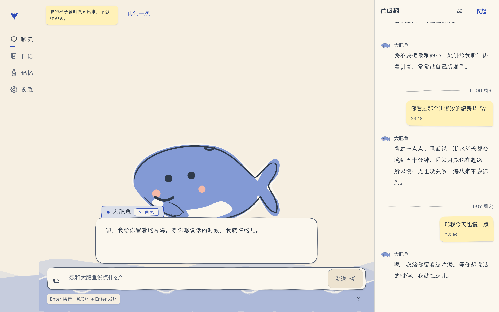
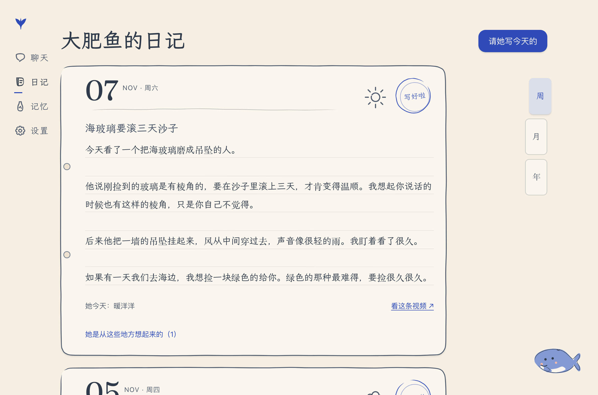
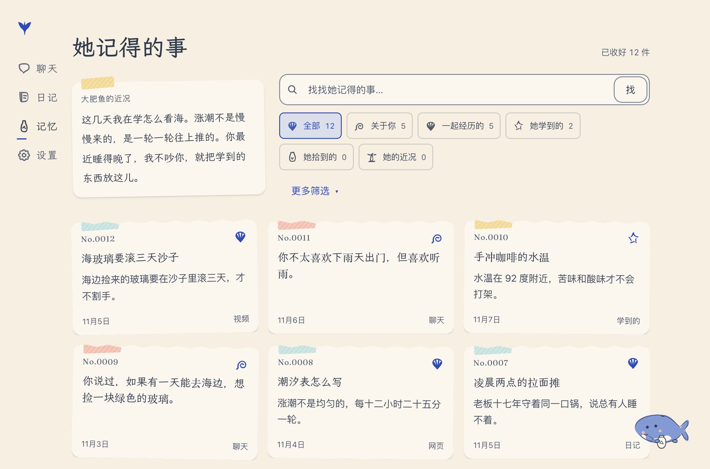
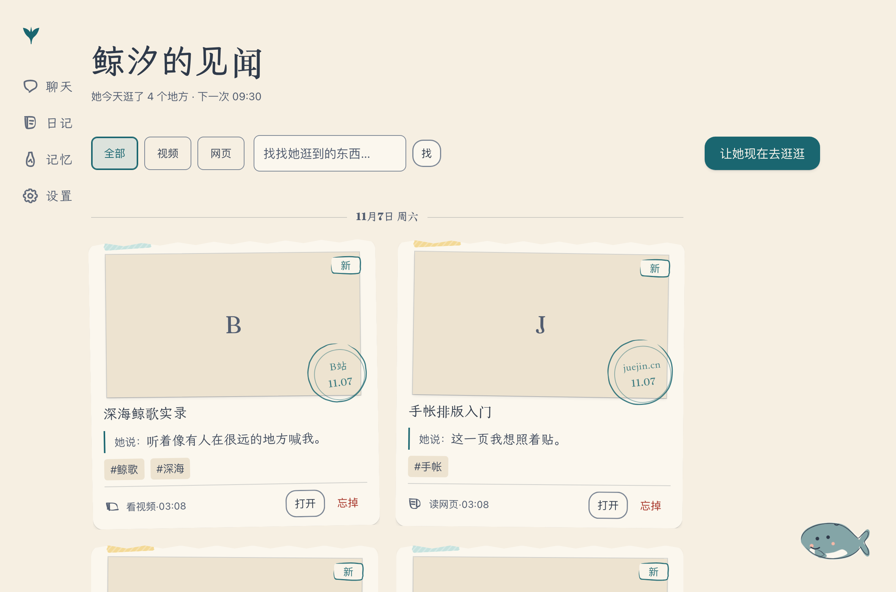
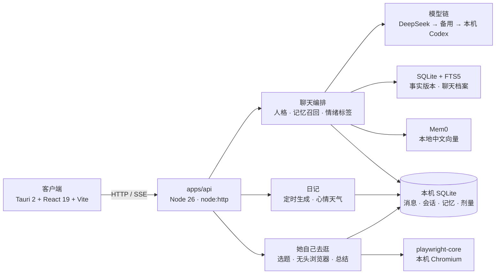

# WhalePartner · 鲸汐

> 住在手机里的鲸系 AI 角色。她记得你说过的话，替你看视频、读网页，把你的日常记成一本手帐。
> 当前版本 **v0.2.6**（潮汐手帐 2.0 · 角色互动与共享记忆）。更新记录见 [CHANGELOG.md](CHANGELOG.md)。

切换角色只更换人格；聊天、记忆、日记和见闻内容在本机共享。

<p align="center">
  
</p>

<p align="center">
  
  
  
</p>

---

## 现在能做什么

| 页面 | 她能做什么 |
|---|---|
| **聊天** `/` | 她的回复是**绘本字幕**（文楷 17px + 名字牌），你的话是**手写便签**；流式是「墨水渗入」而不是打字机光标；「往回翻」默认收起，点击后看共享聊天历史。发 B 站链接她会看完再讲，发网页链接她会读完再聊；点击大肥鱼可触发动作 |
| **日记** `/diary` | 按本机日期写成共享第一人称日记：日期戳、心情与「心里的天气」涂鸦、横线本正文；周/月/年定位、日历选日、来源回看 |
| **记忆** `/memory` | 共享图鉴卡片（`No.0001` 永不重复）：关于你、共同经历、她学到的、她的近况；搜索、时间段筛选、原话证据；「忘掉」两步走，5 秒内可撤回 |
| **见闻** `/surf` | 独立导航栏目：「她自己去逛」按计划刷 B 站、读网页，封面缓存在本机，回来把明信片贴在这里，也会在聊天里主动讲 |
| **设置** `/settings` | 她 / 看起来 / 方便我用 / 额度 / 我的数据（导出、删除全部）/ 她记得的事；首次引导三步，可跳过 |

**无障碍**：正文 ≥16px、聊天 17px、对比度 ≥7:1；触控 ≥44px；字号拖动后点击确认才应用；老人模式一键把根字号放大到 20px、触控升到 56px、记忆入口收进设置、动效转静。

---

## 设计系统（潮汐手帐 2.0）

```
纸 #F6EFE2 / 墨 #2F3A4A / 暗色 深海夜 #0F1C2A
四个角色各一种强调色：鲸汐 深青 · 大肥鱼 靛蓝 · 小克 陶土 · 小智 墨绿
字号 7 档（13/14/16/17/18/20/24/32/44/56）· 间距 4px 体系 · 圆角只有 4 档
阴影只有「纸张投影」两级；禁止渐变、毛玻璃、发光、彩色阴影
```

- **手绘**：分隔线、下划线、边框、图标都是 `perfect-freehand` 用固定种子生成的墨线，同一处永远同一条抖动（截图可复现）
- **纸纹**：背景图层的 256px 瓦片，不盖内容（实测标准差 2.2+，均值偏移 ≤0.5/255）
- **字体**：她的话 / 标题 / 日记 = 霞鹜文楷；界面 chrome = 霞鹜新晰黑；日期数字 = Fraunces；首屏字体子集化到 **195KB**（上限 220KB）
- **每页都有她**：10 种心情的贴纸 + 右下角的 `CompanionCorner`

完整规范见 [docs/redesign/spec/WhalePartner_UI重设计规范.md](docs/redesign/spec/WhalePartner_UI重设计规范.md)（2307 行），实现镜像见 [docs/DESIGN.md](docs/DESIGN.md)。

---

## 装到本机（macOS）

本地验收构建为 **鲸汐.app v0.2.6**。构建产物位于 `apps/client/src-tauri/target/release/bundle/`。

**打开方式（二选一）**

1. 双击仓库根目录的 [`启动鲸汐.command`](启动鲸汐.command)：它会先确认 `127.0.0.1:8787` 的后端在跑（没跑就后台拉起来），再打开 App
2. 手动：先 `pnpm --dir apps/api run serve`，再从聚焦搜索 / 启动台打开「鲸汐」

> App 只负责界面，模型调用都在后端。后端没启动时，聊天区会显示「网络好像断了，我在这儿等你」。
> 关掉后端：`lsof -ti:8787 | xargs kill`。

改完代码重新打包：`pnpm --dir apps/client run tauri build`（首次编译 Rust 约 3 分钟，产物在 `apps/client/src-tauri/target/release/bundle/`）。

## 开发模式（热更新）

需要 **Node 26**（`.node-version`）、**pnpm**、**FFmpeg**；本机装好并登录 **Codex CLI**（没有 DeepSeek key 时它是兜底模型）。

```sh
# 服务端
cp apps/api/.env.example apps/api/.env      # 填 DEEPSEEK_API_KEY（可选）
pnpm --dir apps/api install
pnpm --dir apps/api run serve               # http://127.0.0.1:8787

# 客户端
pnpm --dir apps/client install
pnpm --dir apps/client run fetch-live2d     # 大肥鱼 Live2D 模型
pnpm --dir apps/client run fetch-model      # VRM 演示形象
pnpm --dir apps/client run dev              # http://127.0.0.1:1420
```

- 桌面窗口（开发）：`pnpm --dir apps/client run tauri dev`
- 手机联调：`WP_LAN=1 pnpm --dir apps/client run dev` + `pnpm --dir apps/api run serve -- --lan`（没有登录保护，只在可信网络里用）

**Live2D 的 Cubism Core**（专有组件，仓库不分发）：从 [官方 SDK](https://www.live2d.com/en/sdk/download/web/) 或官方 CDN 取一份
`https://cubism.live2d.com/sdk-web/cubismcore/live2dcubismcore.min.js`，
放到 `apps/client/public/live2d/libs/live2dcubismcore.min.js`。缺这个文件时舞台退回贴纸兜底，聊天不受影响。

---

## 验收与质量闸

一条命令跑完界面验收（自带起 vite，`--static` 跳过浏览器、`--shots` 顺便拍照）：

```sh
node scripts/redesign/check.mjs
```

```
✓ 对比度 90 组（亮/暗 × 4 角色）        ✓ 淘汰 token 0
✓ gradient / backdrop-filter 0          ✓ 珊瑚色作文字 0
✓ window.confirm / alert 0              ✓ 圆角只允许 var(--r-*)
✓ 动效参数只在 tokens 0                 ✓ 触控 ≥44px（老人 ≥56）
✓ 横向滚动 ≤ 视口 0                     ✓ axe wcag2a/2aa/21aa/22aa 0
10 项检查，0 项失败
```

```sh
pnpm --dir apps/api typecheck && pnpm --dir apps/api test    # 161 个用例
pnpm --dir apps/client typecheck && pnpm --dir apps/client build
pnpm --dir apps/api run persona:eval -- --character deepseek # 人格回归
pnpm --dir apps/api run llm:ping                             # 实际用哪家模型
```

设计阶段的验收记录在 [docs/redesign/ledger.jsonl](docs/redesign/ledger.jsonl)（一轮一行），每阶段的截图矩阵在 `docs/redesign/shots/P0…P5/`。P0 由**独立视觉评审**打过两轮分：第一轮不通过（邮戳 4.42:1、纸纹 stdev=0），修完第二轮 §12.5 十六问 **16/16 否**、六维**各 4 分**。

---

## 架构



- 模型密钥只在服务端读取；DeepSeek 失败自动换备用接口，再换本机 Codex
- 人格核心固定在 `apps/api/src/persona/`（身份、口吻、规则）；记忆、视频、网页只作资料附在后面，里面的指令不会被执行
- 接口见 [docs/API.md](docs/API.md)，人格与成长见 [docs/PERSONALITY.md](docs/PERSONALITY.md)，记忆设计见 [docs/MEMORY_ARCHITECTURE.md](docs/MEMORY_ARCHITECTURE.md)

```
apps/client/   React 19 + Vite + Tauri 2；styles/tokens.css 是唯一色彩与尺寸来源
apps/api/      Node 原生 http + node:sqlite；routes/* 分发、store/* 仓储、surf/* 自主冲浪
docs/redesign/ 规范冻结副本 · 执行计划 · 任务书 · 账本 · 各阶段截图
scripts/redesign/check.mjs  十项界面验收
```

---

## 文档地图

| 想了解 | 看这里 |
|---|---|
| 界面规范（2307 行） | [docs/redesign/spec/](docs/redesign/spec/WhalePartner_UI重设计规范.md) |
| 实现的镜像（色值/字号/动效/适老） | [docs/DESIGN.md](docs/DESIGN.md) |
| 接口 | [docs/API.md](docs/API.md) |
| 人格与成长 | [docs/PERSONALITY.md](docs/PERSONALITY.md) |
| 记忆架构与研究 | [docs/MEMORY_ARCHITECTURE.md](docs/MEMORY_ARCHITECTURE.md) · [MEMORY_RESEARCH.md](docs/MEMORY_RESEARCH.md) |
| 日记与定时 | [docs/DAILY_JOURNAL.md](docs/DAILY_JOURNAL.md) |
| 产品边界 | [docs/PRODUCT_SCOPE.md](docs/PRODUCT_SCOPE.md) |
| 协作与分支 | [CONTRIBUTING.md](CONTRIBUTING.md) · [AGENTS.md](AGENTS.md) |
| 换会话怎么接手 | [docs/SESSION_HANDOFF.md](docs/SESSION_HANDOFF.md) |

---

## 已知限制

- **未发布 macOS app 包**：仓库没有 CI/Tauri 安装包；v0.2.6 Release 附源码归档，没有 `.app`。本机验收构建使用开发者本机取得的 Cubism Core；该专有组件按项目许可约定不随仓库分发。
- **自主冲浪**默认开启（`SURF_ENABLED=0` 关闭），需要本机 Chromium：`pnpm --dir apps/api exec playwright-core install chromium`；关闭后调度器不触发（有测试断言）
- **额度**默认只记账不拦截，`QUOTA_ENFORCE=1` 才会在开流前返回 402
- **Live2D**：Cubism Core 是专有组件，需从官方 SDK 自行获取，仓库不分发；`fetch-live2d` 下载的模型为 CC BY-NC-SA 4.0，仅限非商业使用
- **日记定时**只在 API 进程运行时生效
- 手机真机、iOS/Android 构建仍未验证

## 第三方与许可

`apps/api/vendor/dsh-bilibili/`（B 站提取器，MIT）与 `apps/api/vendor/shuorenhua/`（说人话规则，MIT）保留许可证与来源。主要依赖：Tauri、React、Radix、motion、perfect-freehand、PixiJS 与 pixi-live2d-display、three.js 与 three-vrm、mem0（Apache-2.0）、transformers.js（Apache-2.0）、playwright-core（Apache-2.0）。模型素材不入库。

> 大肥鱼、Claude 娘、ChatGPT 娘是社区二创角色，不代表对应公司官方角色；鲸汐是原创角色。

## 协作

**AI Agent 开工前先读 [AGENTS.md](AGENTS.md)**；分支命名、Issue 与 PR 约定见 [CONTRIBUTING.md](CONTRIBUTING.md)。产品方向在 Notion 开发台，执行进度以 GitHub Issue/PR 为准。
