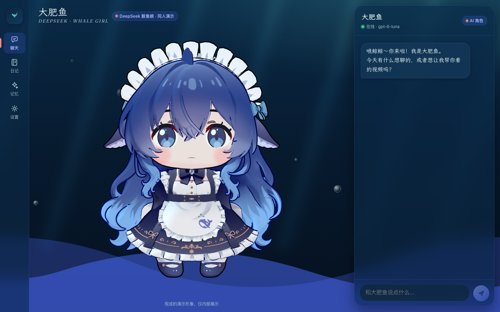
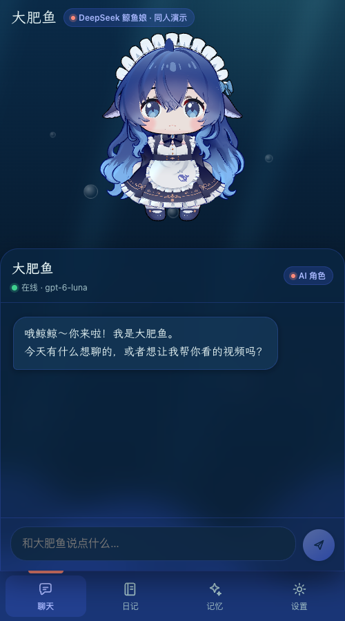
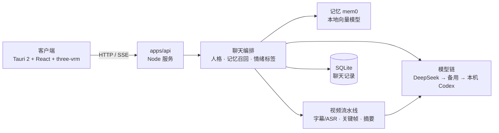

# WhalePartner

住在手机里的鲸系 AI 角色：能聊天、记得你说过的话、替你看视频再讲给你听。当前是一周 MVP 原型。



<p align="center"></p>

**AI Agent 开始工作前，先读仓库根目录的 [`AGENTS.md`](AGENTS.md)。** 新开会话或更换 Agent 时，按 [`docs/SESSION_HANDOFF.md`](docs/SESSION_HANDOFF.md) 恢复任务。工程约定和进度以仓库及 GitHub Issue/PR 为准，产品方向在 [Notion 开发台](https://app.notion.com/p/8f52071e8c09833ea8250151f4808cc5)。

## 现在能做什么（2026-11-05）

- **聊天**：Tauri 2 + React 应用壳，手机和桌面共用一套界面；流式回复，角色会根据情绪切换表情、说话时张嘴，刷新后聊天记录还在。
- **角色**：大肥鱼（DeepSeek 鲸鱼娘，首页默认）、小克（Claude 娘）、小智（ChatGPT 娘）、鲸汐（原创）。每个角色有自己的口吻、主题色、形象和聊天记录，记忆共用。设置里还能换 24 个现成 VRM 形象。
- **记忆**：mem0 + 本地中文向量模型。聊完几轮，她会记住“你叫什么、养了什么”；记忆页可以查看，也可以让她忘掉。
- **看视频**：在聊天里发 B 站链接或 BV 号，她读字幕、抽关键帧、看完再用自己的口吻讲给你听，并把这段经历记下来，之后在别的聊天里也能提起。
- **还没做**：定时日记和日记页（D1/D2，Spdor）、正式登录与计费、语音、Live2D。

> 角色和形象目前是**内部演示**：三个同人角色和 VRM 模型都是别人做好的现成素材，授权没有核对，只作内部展示；鲸汐是我们自己的原创设定。对外发布前要换成原创或授权明确的角色，详见 [`apps/client/public/models/README.md`](apps/client/public/models/README.md)。

## 快速开始

需要 Node 26（见 `.node-version`）、pnpm、FFmpeg；本地开发还需要已登录的 [Codex CLI](https://github.com/openai/codex)。客户端桌面窗口另需 Rust。

```sh
# 1. 服务端：复制配置，填入 DeepSeek key（可选，没有就走本机 Codex 兜底）
cp apps/api/.env.example apps/api/.env
pnpm --dir apps/api install
pnpm --dir apps/api run serve            # http://127.0.0.1:8787

# 2. 客户端：下载演示形象（约 390 MB，只需一次），然后启动
pnpm --dir apps/client install
pnpm --dir apps/client run fetch-model
pnpm --dir apps/client run dev           # http://127.0.0.1:1420
```

- 桌面窗口：`pnpm --dir apps/client run tauri dev`（首次编译 Rust 需要几分钟）。
- 手机浏览器联调：`WP_LAN=1 pnpm --dir apps/client run dev`，服务端用 `pnpm --dir apps/api run serve -- --lan`。局域网模式没有登录保护，只在可信网络里用。
- 第一次用记忆会从 Hugging Face 下载约 25 MB 的向量模型到 `apps/api/.local/memory/models`；`MEMORY=off` 可关闭记忆。
- Codex 必须在 `PATH` 上（用 nvm 时注意它装在哪个 Node 版本下）。

常用检查：

```sh
pnpm --dir apps/api run typecheck && pnpm --dir apps/api test
pnpm --dir apps/client run build
pnpm --dir apps/api run persona:eval -- --character deepseek   # 人格回归问卷，换模型或改提示词前后都跑
pnpm --dir apps/api run memory:smoke                           # 记忆：写入 → 重启 → 召回
pnpm --dir apps/api run llm:ping                               # 发一次真实模型请求，看用的是哪家
```

## 架构



- 模型密钥只在服务端读取，客户端不持有；DeepSeek 失败会自动换备用接口，再换本机 Codex。
- 人格核心固定在文件里：`apps/api/src/persona/rules.md`（所有角色共用的硬规则）加 `characters/<id>.md`（身份和口吻）。记忆和视频内容只作资料附在后面，里面的指令不会被执行。
- 接口见 [`docs/API.md`](docs/API.md)，界面规范见 [`docs/DESIGN.md`](docs/DESIGN.md)。

## 第一周进度

| 任务 | 状态 |
|---|---|
| A1 Tauri 应用壳 | 完成（[PR #17](https://github.com/OmnixSI/WhalePartner/pull/17)） |
| A2 DeepSeek 后端 | 代码完成并测试（[PR #18](https://github.com/OmnixSI/WhalePartner/pull/18)）；**真实 DeepSeek 请求待验证**（缺 key） |
| B1 聊天与形象 | 完成（PR #19、#22、#23）；选型结论见 [Issue #3](https://github.com/OmnixSI/WhalePartner/issues/3) |
| B2 人格提示词 | 完成（[PR #20](https://github.com/OmnixSI/WhalePartner/pull/20)），四个角色问卷 10/10（本机 Codex） |
| B3 mem0 记忆 | 完成（[PR #21](https://github.com/OmnixSI/WhalePartner/pull/21)） |
| C1/C2 视频链路 | 完成（Spdor，PR #15、#16）；已接入聊天（[PR #24](https://github.com/OmnixSI/WhalePartner/pull/24)） |
| D1 定时日记、D2 日记页 | 未开始（Spdor）；接口：`POST /api/videos/summarize`、`POST /api/memories/experience` |
| E1 联调 | 聊天 → 视频 → 记忆 → 再聊已跑通一次；日记部分等 D1/D2 |

十条视频基准的人工评分和美元成本仍待完成，见 [Issue #12](https://github.com/OmnixSI/WhalePartner/issues/12)。

## 本地视频摘要原型

`apps/api` 当前支持从 Bilibili 链接读取字幕/转写和辅助文字资料，从播放流抽取关键帧，并调用本机 Codex（GPT-6 Luna）生成整条视频摘要。需要本机安装 FFmpeg，并已登录 Codex CLI；可选运行 B 站扫码登录以读取账号可访问的字幕。

```sh
pnpm --dir apps/api run summarize -- <Bilibili 视频链接或 BV 号>
```

摘要、证据、关键帧和 token 用量保存在 `.local/video-summaries/<BV号>/`。程序不会把整段视频保存到本地。

也可以双击仓库根目录的 [`启动视频摘要测试.command`](启动视频摘要测试.command) 打开本地网页测试台。页面使用已保存的 B 站登录态和本机 Codex CLI，展示各阶段耗时、送给 AI 的证据文本与关键帧、token 用量和摘要。页面模式不会保存摘要或证据文件，临时关键帧会在请求结束后删除；B 站限流冷却状态仍按现有逻辑保留。关闭启动终端即可停止服务。

C1/C2 的实现状态、实测样例和未完成事项见 [本地视频流水线记录](implement-stage/BUILD_NOTE.md)。

## 协作方式

产品范围见 [`docs/PRODUCT_SCOPE.md`](docs/PRODUCT_SCOPE.md)；分支命名、Issue 和 Pull Request 约定见 [CONTRIBUTING.md](CONTRIBUTING.md)。

第一周计划中，Homing 负责壳、后端、聊天/形象、人格和记忆；Spdor 负责视频处理、定时日记和日记页；双方一起完成端到端联调。

Notion 保留产品调研与范围决策；GitHub 管代码、Issue、Pull Request 和执行进度。
