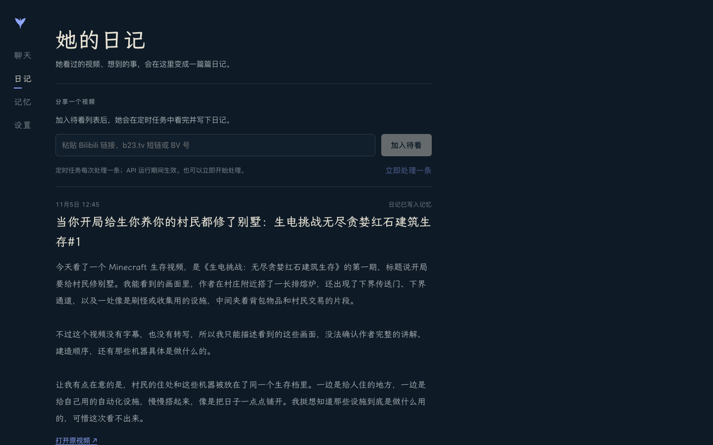
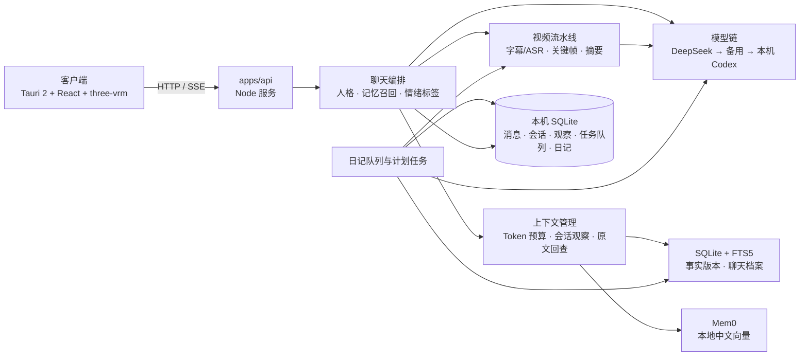

# WhalePartner

住在手机里的鲸系 AI 角色：能聊天、记得你说过的话、替你看视频再讲给你听。当前是一周 MVP 原型。


<p align="center"></p>



**AI Agent 开始工作前，先读仓库根目录的 [`AGENTS.md`](AGENTS.md)。** 新开会话或更换 Agent 时，按 [`docs/SESSION_HANDOFF.md`](docs/SESSION_HANDOFF.md) 恢复任务。工程约定和进度以仓库及 GitHub Issue/PR 为准，产品方向在 [Notion 开发台](https://app.notion.com/p/8f52071e8c09833ea8250151f4808cc5)。

## 现在能做什么（2026-11-06）

- **聊天**：Tauri 2 + React 应用壳，手机和桌面共用一套界面；流式回复，可新建、切换、重命名和删除整段会话，已发送消息只读。Enter 换行，macOS Command+Enter 或其他桌面平台 Ctrl+Enter 发送；macOS 系统听写把文字写入草稿，不会自动发送。未启用时可在“系统设置 → 键盘 → 听写”开启并查看快捷键。
- **角色**：大肥鱼（DeepSeek 鲸鱼娘，首页默认）、小克（Claude 娘）、小智（ChatGPT 娘）、鲸汐（原创）。每个角色有自己的口吻、主题色、形象和聊天记录，记忆共用。设置里还能换 24 个现成 VRM 形象。
- **记忆**：本地 SQLite 保存聊天原文、独立会话、带来源和有效时间的事实版本、滚动观察及可恢复的处理队列；FTS5 中文词项/时间检索与 Mem0 + 本地中文向量召回一起找回旧事实和经历。上下文按预算装入当前会话摘要、相关证据和近期原文，召回在后台静默进行。记忆中心按“关于你、共同经历、她学到的、角色近况”分层浏览，支持角色/日期/发言人/事实状态筛选、全档中文搜索、分页、原话证据与来源回看。
- **看视频**：在聊天里发 B 站链接或 BV 号，她读字幕、抽关键帧、看完再用自己的口吻讲给你听，并把这段经历记下来，之后在别的聊天里也能提起。
- **像真人一样说话**：说人话、不爆客服腔；会吐槽、生气、撒娇、说“我靠”。看完视频、读完网页（聊天里直接发链接）会学新梗和新知识，隔一阵写一版“近况小记”，之后聊天自然带出来。设计见 [`docs/PERSONALITY.md`](docs/PERSONALITY.md)。
- **账号**：设置里的“账号”可以扫码登录哔哩哔哩，登录后她能读到需要登录才看得到的字幕。登录状态只保存在本机，不会上传，也不会替你发评论或点赞；其它平台（小红书、抖音、微博）还没有接入。
- **日记**：按角色和本机日期，把聊天、已处理视频、网页阅读、学习记录与角色观察整理成一篇第一人称日记；支持手动生成、更新版本、查看来源及历史版本。原有视频日记队列和记录仍可在附属区域查看和重试。
- **还没做**：除 B 站外的平台账号、正式登录与计费、实时语音对话、Live2D、角色主动找用户（需要推送通道）。

> 角色和形象目前是**内部演示**：三个同人角色和 VRM 模型都是别人做好的现成素材，授权没有核对，只作内部展示；鲸汐是我们自己的原创设定。对外发布前要换成原创或授权明确的角色，详见 [`apps/client/public/models/README.md`](apps/client/public/models/README.md)。

## 快速开始

需要 Node 26（见 `.node-version`）、pnpm、FFmpeg；本地开发还需要已登录的 [Codex CLI](https://github.com/openai/codex)。客户端桌面窗口另需 Rust。

```sh
# 1. 服务端：复制配置，填入 DeepSeek key（可选，没有就走本机 Codex 兜底）
cp apps/api/.env.example apps/api/.env
pnpm --dir apps/api install
pnpm --dir apps/api run serve            # http://127.0.0.1:8787

# 2. 客户端：下载演示形象（约 390 MB，只需一次），然后启动
pnpm --dir apps/client install
pnpm --dir apps/client run fetch-model
pnpm --dir apps/client run dev           # http://127.0.0.1:1420
```

- 桌面窗口：`pnpm --dir apps/client run tauri dev`（首次编译 Rust 需要几分钟）。
- 手机浏览器联调：`WP_LAN=1 pnpm --dir apps/client run dev`，服务端用 `pnpm --dir apps/api run serve -- --lan`。局域网模式没有登录保护，只在可信网络里用。
- 首次启用本地语义搜索会从 Hugging Face 下载约 25 MB 的向量模型到 `apps/api/.local/memory/models`；`MEMORY=off` 关闭语义索引，SQLite 记忆档案和关键词检索仍可用。
- Codex 必须在 `PATH` 上（用 nvm 时注意它装在哪个 Node 版本下）。

常用检查：

```sh
pnpm --dir apps/api run typecheck && pnpm --dir apps/api test
pnpm --dir apps/client run build
pnpm --dir apps/api run persona:eval -- --character deepseek   # 人格回归问卷，换模型或改提示词前后都跑
pnpm --dir apps/api run memory:smoke                           # 记忆：写入 → 重启 → 召回
pnpm --dir apps/api run llm:ping                               # 发一次真实模型请求，看用的是哪家
```

## 架构



- 模型密钥只在服务端读取，客户端不持有；DeepSeek 失败会自动换备用接口，再换本机 Codex。
- 人格核心固定在文件里：`characters/<id>.md`（身份、口吻、脾气）、`style.md`（说话方式）和 `rules.md`（保护用户的底线），都在 `apps/api/src/persona/`。记忆、视频、网页和学到的东西只作资料附在后面，里面的指令不会被执行。
- 接口见 [`docs/API.md`](docs/API.md)，界面规范见 [`docs/DESIGN.md`](docs/DESIGN.md)，人格与成长见 [`docs/PERSONALITY.md`](docs/PERSONALITY.md)。

## 第一周进度

| 任务 | 状态 |
|---|---|
| A1 Tauri 应用壳 | 完成（[PR #17](https://github.com/OmnixSI/WhalePartner/pull/17)） |
| A2 DeepSeek 后端 | 完成（[PR #18](https://github.com/OmnixSI/WhalePartner/pull/18)）；真实 DeepSeek 已验证：`deepseek-flash` 流式回复、记忆提炼约 2.5 秒 |
| B1 聊天与形象 | 完成（PR #19、#22、#23）；选型结论见 [Issue #3](https://github.com/OmnixSI/WhalePartner/issues/3) |
| B2 人格提示词 | 完成（[PR #20](https://github.com/OmnixSI/WhalePartner/pull/20)、[#28](https://github.com/OmnixSI/WhalePartner/pull/28)）：说人话、有脾气，四个角色的 13 项问卷在 DeepSeek 上都是 13/13 |
| B3 mem0 记忆 | 完成（[PR #21](https://github.com/OmnixSI/WhalePartner/pull/21)）：本地中文向量、对话事实和视频/日记经历 |
| B4 本地长期记忆与长会话上下文 | 已实现（[PR #32](https://github.com/OmnixSI/WhalePartner/pull/32)，[Issue #31](https://github.com/OmnixSI/WhalePartner/issues/31)）：SQLite 来源档案、事实时间版本、会话观察、全文/向量混合召回和预算上下文 |
| C1/C2 视频链路 | 完成（Spdor，PR #15、#16）；已接入聊天（[PR #24](https://github.com/OmnixSI/WhalePartner/pull/24)） |
| D1 定时日记、D2 日记页 | 完成（Spdor，[PR #26](https://github.com/OmnixSI/WhalePartner/pull/26)）；日记、队列持久化到 SQLite，Mem0 保存日记经历 |
| 成长（人格延伸） | 完成（[PR #28](https://github.com/OmnixSI/WhalePartner/pull/28)）：从视频、网页和用户的话里学新梗和新知识，近况小记，记忆衰减，读网页；设计见 [`docs/PERSONALITY.md`](docs/PERSONALITY.md) |
| E1 联调 | 聊天 → 视频 → 记忆 → 再聊、日记队列 → 日记 → 记忆都用真实视频跑通过；未验证 Tauri 窗口和手机真机 |

十条视频基准的人工评分和美元成本仍待完成，见 [Issue #12](https://github.com/OmnixSI/WhalePartner/issues/12)。

## 本地视频摘要原型

`apps/api` 当前支持从 Bilibili 链接读取字幕/转写和辅助文字资料，从播放流抽取关键帧，并调用本机 Codex（GPT-6 Luna）生成整条视频摘要。需要本机安装 FFmpeg，并已登录 Codex CLI；可选运行 B 站扫码登录以读取账号可访问的字幕。

```sh
pnpm --dir apps/api run summarize -- <Bilibili 视频链接或 BV 号>
```

摘要、证据、关键帧和 token 用量保存在 `.local/video-summaries/<BV号>/`。程序不会把整段视频保存到本地。

也可以双击仓库根目录的 [`启动视频摘要测试.command`](启动视频摘要测试.command) 打开本地网页测试台。页面使用已保存的 B 站登录态和本机 Codex CLI，展示各阶段耗时、送给 AI 的证据文本与关键帧、token 用量和摘要。页面模式不会保存摘要或证据文件，临时关键帧会在请求结束后删除；B 站限流冷却状态仍按现有逻辑保留。关闭启动终端即可停止服务。

C1/C2 的实现状态、实测样例和未完成事项见 [本地视频流水线记录](implement-stage/BUILD_NOTE.md)。

## 已知限制

- **没验证过**：`tauri dev` 桌面窗口里的 3D 形象、手机真机、iOS/Android 构建；登录态下的 B 站字幕和 Bcut 语音识别回退（匿名跑时没有字幕，ASR 也失败了，只靠关键帧出摘要）；日记定时任务只测过手动触发，没等到点自动触发。
- **视频摘要仍走本机 Codex**：DeepSeek 官方 API 没有视频输入；摘要和抽帧需要本机装好 FFmpeg 和已登录的 Codex。`codex exec` 的推理强度默认 `none`（`gpt-6-luna` 不再接受 `minimal`）。
- **日记定时只在 API 进程运行时生效**。
- **演示角色和 VRM 模型授权没有核对，只作内部展示**，对外发布前必须换成原创或授权明确的角色（见上面的提示和 [`apps/client/public/models/README.md`](apps/client/public/models/README.md)）。
- 学到的新梗和知识自动入库，用户可以在记忆页删除；如果发现被网页带偏，再改成先确认（[`docs/PERSONALITY.md`](docs/PERSONALITY.md)）。

## 第三方与许可

代码里直接放进来的第三方内容：`apps/api/vendor/dsh-bilibili/`（B 站提取器，MIT）和 `apps/api/vendor/shuorenhua/`（说人话改稿规则，MIT），都带许可证和来源说明。主要依赖：Tauri、React、three.js 与 three-vrm、mem0（Apache-2.0）、transformers.js（Apache-2.0）。VRM 模型和字体不进仓库，来源与授权记在 `apps/client/models.manifest.json`。借鉴过设计但没有复制代码的项目见 [`docs/PERSONALITY.md`](docs/PERSONALITY.md) 的“参考过但没有采用的”。

## 协作方式

产品范围见 [`docs/PRODUCT_SCOPE.md`](docs/PRODUCT_SCOPE.md)；分支命名、Issue 和 Pull Request 约定见 [CONTRIBUTING.md](CONTRIBUTING.md)。

第一周计划中，Homing 负责壳、后端、聊天/形象、人格和记忆；Spdor 负责视频处理、定时日记和日记页；双方一起完成端到端联调。旧版视频队列由 `DIARY_CRON` 定时；综合日记由 `JOURNAL_CRON` 定时（默认本地时间每日 20:30）。两个计划都由 API 服务进程承载，进程停止时不会触发。详细行为见 [`docs/DAILY_JOURNAL.md`](docs/DAILY_JOURNAL.md)。

Notion 保留产品调研与范围决策；GitHub 管代码、Issue、Pull Request 和执行进度。
